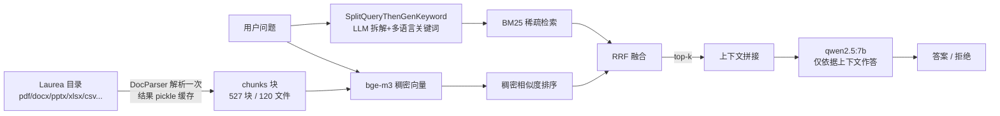

# RAG 架构复盘（`rag_pro/`）

> 目的：把这个 RAG 的**每个零件在干什么**讲清楚，方便你学习，也方便后面接"幻觉探针"实验。
> 这里刻意用**成熟库（Qwen-Agent）打底**，而不是从零手写 —— 手写版留在 `rag/` 当对照/消融基线。

---

## 1. 一句话总览

> **解析一次 → 切块 → 每条问题：生成关键词 + 稠密向量 → 混合检索（BM25 + bge-m3，RRF 融合）→ 拼上下文 → 7B 生成（带"查不到就拒绝"约束）。**

---

## 2. 每个工具/模块的作用

### 2.1 解析层 —— `qwen_rag.py::parse_all()`
| 工具 | 作用 | 为什么用它 |
|---|---|---|
| **Qwen-Agent `DocParser`** | 把 pdf/docx/pptx/xlsx/csv/html 统一解析成**带页码/块 id 的 chunks** | 手写 `python-docx` 会漏掉 **docx 表格**（你的 Corpus 大量是表格，比如钓鱼邮件练习文件全是表格）。DocParser 原生处理表格，这是"别重造轮子"的直接收益。 |
| **pickle 缓存** | 解析结果存 `.parse_cache_*.pkl` | 解析 181 个文件很慢，重复问答不该重解析。 |
| **文件名注入** | 每块前面加 `[file: ...]`，并把 `_ - .` 换成空格 | 很多文档的"主题词"只存在于**文件名**里（如 `Wu_Shuang_Phishing-Email-Practise.docx`），正文没写"phishing"。同时防止 `phishing` 和整串文件名被当成一个 token。 |

### 2.2 查询层 —— `qwen_rag.py::keywords_for()`
| 工具 | 作用 | 为什么用它 |
|---|---|---|
| **Qwen-Agent `SplitQueryThenGenKeyword`** | 用 LLM 把问题拆成子查询，并生成**中英双语关键词** | 应对多词/专有名词问题；也让 BM25 在中文提问时能命中英文/芬兰语正文。 |
| （备选）直接拿原问题 | —— | 关键词生成偶尔会加进 `student / learn` 这种"泛词"，反而拉高长文档的 BM25 分数（噪声来源之一，见 §4）。 |

### 2.3 检索层 —— `qwen_rag.py::retrieve_hybrid()`
这是**核心**，两条腿走路：

| 组件 | 类型 | 作用 | 弱点 |
|---|---|---|---|
| **`KeywordSearch`（rank_bm25）** | 稀疏检索 | 精确词面命中，专有名词/文件名很准 | 遇到 `student/learn` 这种**泛词**，会把长文档（Guidelines、study plan）顶上来 → 噪声 |
| **`embed.embed()`（Ollama `bge-m3`）** | 稠密检索 | **多语言**语义匹配（芬兰语/英文/中文互通），能跨越词面不一致 | 分数被压得很扁（0.4–0.7 都挤在一起），绝对阈值不好设；对"表格/练习稿"这类语义弱文档不敏感 |
| **RRF（Reciprocal Rank Fusion）** | 融合 | 只按**排名**融合两路结果，无需归一化分数：`score = Σ 1/(60+rank)` | —— |

> 为什么必须混合？你的语料是**芬兰/英语混合**（Laurea），问题常是英文。纯 BM25 在跨语言时失效（芬兰语正文 vs 英文问题）；纯稠密在专有名词/文件名上不够锐利。RRF 让两者互补。

### 2.4 重排层 —— `rerank.py::Reranker`（**当前默认关闭**）
| 组件 | 作用 | 现状 |
|---|---|---|
| **`bge-reranker-base`**（cross-encoder） | 对候选块做 query-passage 精排 | **英文专用模型**，在你的芬兰语语料 + 中文查询上严重失配（相关文档打分 ~0.0003，无关文档反而 0.43）。所以默认关闭，仅用 `--rerank` 可开。**正确解法是换多语言 reranker（`bge-reranker-v2-m3`），见 §6。** |

### 2.5 生成层 —— `qwen_rag.py::ollama_answer()`
| 组件 | 作用 |
|---|---|
| **Ollama `qwen2.5:7b`** + `temperature=0` | 仅依据拼好的上下文作答；查不到时要求**原样输出「资料中没有相关信息」**（这就是最朴素的"拒答"，也是接探针的挂钩点）。 |
| 为什么 7B 而不是 0.8B | 抽取质量：小模型会把上下文里没有的东西编出来；7B 至少会拒绝（虽然也常过度拒绝，见 §4）。 |

### 2.6 评测层 —— `eval_rag.py`
| 组件 | 作用 |
|---|---|
| 8 条人工题 + 可接受子串（中英双语备选） | 量化"及格线"，避免自我感觉良好。 |
| **诚实判定** | 答案含 `no mention / was not discussed / does not contain ...` 等**否定/搪塞措辞**也算 FAIL —— 否则 7B 的"查无此信息"会被子串误判成 PASS（这是之前 88% 虚高的原因）。 |
| `PASS_BAR = 0.75` | 达到才提示"可以开始写探针"。 |

---

## 3. 一次问答具体发生了什么

1. `parse_all()` 读缓存（或首次解析 120 文件 → 527 个块）。
2. `keywords_for()` 让 7B 生成关键词 → `student, learn, phishing, 学生, 学习, 钓鱼`。
3. `retrieve_hybrid()`：
   - BM25 用关键词在全部块上打分排序；
   - bge-m3 把**原问题**转向量，和 527 个块向量算余弦排序；
   - RRF 合并两路 → top-12 候选 → 取 top-k（默认 6）。
4. `ollama_answer()` 把 top-k 块拼成上下文，7B 作答（或拒绝）。
5. `eval_rag.py` 判定 PASS/FAIL。

---

## 4. 当前真实状态（诚实版）

**没到及格线。** 而且之前的 88%/62% 都偏乐观（模型大量在答 "does not mention / was not discussed"，被子串误判）。

按严格判定，真实通过率约 **2–5 / 8**。三个失败模式已定位：

1. **泛词噪声**：`student / learn` 这类词让 `Guidelines_for_referencing.pdf`、`study plan.docx` 靠 BM25 挤进 top-k，7B 被带跑偏（问 phishing 却答成 Ionic 项目）。
2. **多页文档的答案块没进 top-k**：合同签名在**最后一页**，但检索只回溯到该文档第一块（标题页）。问"谁签的字"，答案块根本没被捞到。
3. **英文 reranker / 语义弱文档**：`bge-reranker-base` 对芬兰语失配；`Phishing-Email-Practise.docx` 是"邮件练习表格"，语义上与"学了什么"不接近，稠密只排第 4（靠 BM25 才夺冠）。

> 这说明：**不是解析坏了，是"检索精度 + 上下文信噪比"没到线**。这正是后面探针要检测的东西 —— 但你说过要先到及格线再写探针，所以我们先补检索。

---

## 5. 两条路线的定位

| | `rag/`（手写） | `rag_pro/`（成熟库，主用） |
|---|---|---|
| 解析 | 自己写 docx/表格/csv 加载 | Qwen-Agent `DocParser` |
| 检索 | bge-small-en 向量 + BM25 + RRF | bge-m3（多语言）+ BM25 + RRF |
| 生成 | qwen2.5 | qwen2.5:7b |
| 定位 | **消融基线 / 学习对照** | **主力** |

---

## 6. 到及格线的下一步（按性价比排序）

1. **换多语言 reranker：`BAAI/bge-reranker-v2-m3`**（配 `retrieve_k=20` 再精排到 top-5）。
   —— 直接针对失败模式 3，也是"成熟方案"（BGE 官方多语言重排器）。约 2.2GB 下载。
2. **候选池加大 + 页面级召回**：`retrieve_k` 提到 20，让"签名页"这类**后置块**有机会进候选，再由 reranker 挑。
3. **泛词抑制**：关键词生成后过滤掉高频泛词（保留 IDF 高的词），减少失败模式 1。
4. **评测题要"对得上语料"**：部分题（如"学了什么 phishing"）在语料里可能本就没有"学习心得"文本，属于**题目不可答**，应改成语料确实包含的事实题，指标才可信。

> 这几步做完，再把 `eval_rag.py` 跑到 ≥75%，就是"可以开始写探针"的信号。

---

## 7. 与"幻觉探针"的接口

这个 RAG 天然给了探针三个可观测信号（后面写探针直接用）：
- **检索置信度**：top-1 与 top-k 的分数/是否为空 → 检索是否失败；
- **拒答标记**：生成是否命中「资料中没有相关信息」；
- **答案-上下文一致性**：答案里的实体是否能在被检索块中找到（NLI / 子串 / 归一化匹配）。

> 探针实验的科学目标：**在"检索会失败"的真实 RAG 上，衡量"探针能否提前发现失败"，而不是靠构造假数据。** 所以当前这些失败模式，恰恰是有价值的实验素材。
